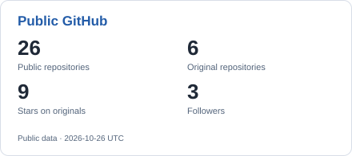
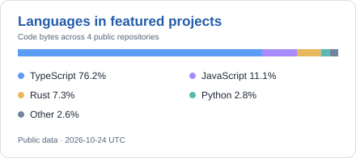

# Hi, I'm lolipop-1x1 👋

**Building tools for better AI-assisted development.**

构建实用的 AI 开发工具，让上下文更清楚、工作流更顺手。

<picture>
  <source media="(prefers-color-scheme: dark)" srcset="assets/workflow-dark.svg">
  <source media="(prefers-color-scheme: light)" srcset="assets/workflow-light.svg">
  
</picture>

[Projects](#-featured-projects) · [Toolbox](#-toolbox) · [Open Source](#-open-source)

---

### 🧑‍💻 About Me

- 🛠 I build **AI developer tools and DeepSeek Harness plugins**.
- 🧵 I care about **conversation context** — picking up a task and understanding what matters.
- 🔍 I explore **local observability** — seeing which processes touch project files.
- 🌱 My current public work spans **TypeScript, Rust, and Python**.

---

### 🔥 Featured Projects

<table>
<tr>
<td width="50%" valign="top">

<h3 align="center"><a href="https://github.com/lolipop-1x1/dsh-recap">🧵 DSH Recap</a></h3>

<strong>Pick up where you left off.</strong>

A session recap plugin for DeepSeek Harness. Get a brief view of the current task, completed work, and next steps with `/recap` or automatic idle summaries.

TypeScript · Harness plugin

</td>
<td width="50%" valign="top">

<h3 align="center"><a href="https://github.com/lolipop-1x1/dsh-you-should-know">💡 You Should Know</a></h3>

<strong>Keep useful context in view.</strong>

A task reminder plugin for DeepSeek Harness. Surface important facts, trade-offs, and background knowledge while an AI agent works, with explanations on demand.

TypeScript · Harness plugin

</td>
</tr>
<tr>
<td colspan="2" valign="top">

<h3 align="center"><a href="https://github.com/lolipop-1x1/CodePerimeter">🔍 CodePerimeter</a></h3>

<strong>Know what touches your code.</strong>

A local-first macOS monitor for project-file activity. Review file access, archive indicators, and alerts, then investigate the evidence in a bilingual web console.

Rust · TypeScript · Python · Experimental · macOS

Observes and alerts; it does not block file access or network transmission.

</td>
</tr>
</table>

---

### 🛠 Toolbox

  
  
  
  
  

---

### 📊 Open Source

<picture>
  <source media="(prefers-color-scheme: dark)" srcset="assets/profile-dark.svg">
  <source media="(prefers-color-scheme: light)" srcset="assets/profile-light.svg">
  
</picture>
<picture>
  <source media="(prefers-color-scheme: dark)" srcset="assets/languages-dark.svg">
  <source media="(prefers-color-scheme: light)" srcset="assets/languages-light.svg">
  
</picture>

About these numbers

The snapshot refreshes daily from public GitHub data. Original repositories exclude forks; stars are summed over those repositories. Languages measure code bytes across the three featured projects and do not represent proficiency. The contribution animation uses this account's contribution calendar as visible to the workflow token.

---

### 🐍 Contribution Trail

<picture>
  <source media="(prefers-color-scheme: dark)" srcset="assets/contributions-dark.svg">
  <source media="(prefers-color-scheme: light)" srcset="assets/contributions-light.svg">
  
</picture>

Thanks for stopping by. Explore a project, try a tool, or share an idea in its Issues.

